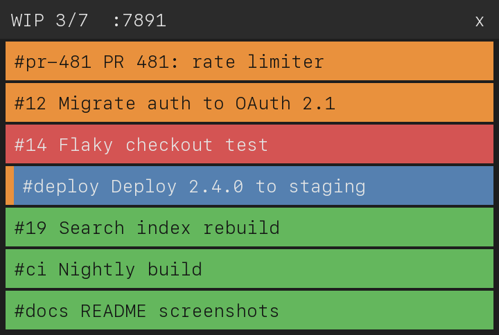
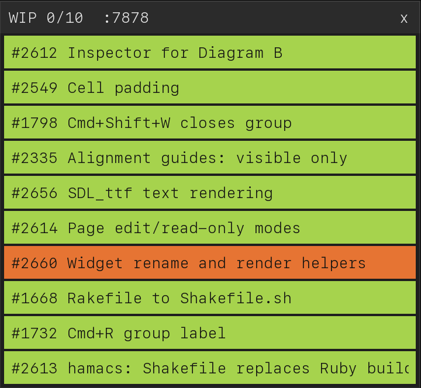

# wip

wip shows a list of work items in a small window that stays on top of other
windows. wip also shows each item on an Elgato Stream Deck key.
Agents and scripts add and update items through the wip CLI or the wip MCP server.

Each item has a status and a color:

- Orange: the work is in progress.
- Green: the work is done.
- Any other color: set with `wip add --color` or `wip color`. For example, use
  red to mark work that waits for you.

When you click an item or press the item key on the Stream Deck, wip opens the
item URL.

## Window

- Click an item to open the item URL.
- Cmd-click an item to delete the item (macOS only).
- Drag an item to change the item order.
- Drag the window header to move the window.
- Click `x` to quit wip.

On macOS, the wip window stays on top of all apps on every Space, including
full-screen apps. The wip window never takes keyboard focus.

## Stream Deck

wip controls the Stream Deck: wip sets the key images and reacts to key presses.
wip uses [elgato-streamdeck](https://github.com/exlee/haskell-elgato-streamdeck),
a Haskell port of the Rust crate, to talk to the device.
wip is tested with the Stream Deck Neo.

wip uses the first Stream Deck that is connected. Each item gets one key.
The key shows the item title on the item color.
wip sorts keys by the time of the last change to the item (add or status
change), with the most recent change first. Every change shows page 1 again.

- Press a key to open the item URL.
- Hold a key for 0.6 seconds to delete the item.
- Stream Deck Neo: press the left or right touch button to show the previous or
  next page. The Neo info screen shows `Working X / Done Y / Total Z` and the
  page number.
- Stream Deck models without touch buttons: when the items do not fit on one
  page, the last key shows the next page.

wip makes a key title smaller until the title fits the key. wip does not break
words in a title. When the text size reaches 11% of the key height and a word
still does not fit, wip hyphenates the word at a syllable.

When wip quits, wip clears all keys and the Neo info screen.
When you unplug the Stream Deck and plug the Stream Deck in again, wip
reconnects.

## RACE

[RACE](https://race-term.com) is a terminal app. Each RACE terminal has a
`race://terminal/N` deep link.

The `race-wip-status` skill gives each Claude session one wip item. The item
URL is the deep link of the RACE terminal where the Claude session runs.
When you click the item in the wip window or press the item key on the Stream
Deck, RACE focuses that terminal.
See [Claude skills](#claude-skills) to install the skill.

## Install

1. Download the binary for your system from
   [GitHub releases](https://github.com/exlee/wip/releases).
2. Install the libraries that wip loads at runtime: SDL3, SDL3_ttf, hidapi and
   libturbojpeg.
   - macOS: `brew install sdl3 sdl3_ttf hidapi jpeg-turbo`
   - Linux: install the SDL3, SDL3_ttf, hidapi and libturbojpeg packages of
     your distribution.
3. Linux only: copy
   [`40-streamdeck.rules`](https://github.com/exlee/haskell-elgato-streamdeck/blob/main/40-streamdeck.rules)
   to `/etc/udev/rules.d/`, then unplug the Stream Deck and plug the Stream
   Deck in again.

When a library is missing:

- Without SDL3, wip cannot show the window. Run wip with `--no-ui`.
- Without SDL3_ttf, wip uses the ASCII-only `SDL_RenderDebugText` font.
- Without hidapi, wip does not use the Stream Deck.

## Run

    wip --port 7878

| Option | Effect |
|---|---|
| `--port N` | HTTP port for the MCP server and the CLI (default 7878) |
| `--no-ui` | No window |
| `--no-deck` | No Stream Deck |
| `--font PATH` | Font file (default SF Mono, then Menlo, then DejaVu Sans Mono) |
| `--state PATH` | Session file (see [Session](#session)) |
| `--no-state` | Do not load or save the session |

## CLI

The wip CLI sends commands to a running wip instance on port 7878.
Use `--port N` for another port.

    wip add --url=https://example.com Fix the build   # prints the item id; --url is optional
    wip add --id=pr-42 Review PR 42                   # sets the item id; adding the same id again updates the item
    wip add --color=steelblue Deploy                  # color: CSS color name or hex (#f80, #ff8800)
    wip done pr-42
    wip color pr-42 '#f80'                            # color name, hex, or none to remove the color
    wip delete pr-42
    wip list                                          # prints id, status, title and URL, separated by tabs

## MCP

The wip MCP server uses Streamable HTTP at `http://127.0.0.1:7878/mcp`.
To add the wip MCP server to Claude Code:

    claude mcp add --transport http wip http://127.0.0.1:7878/mcp

| Tool | Arguments |
|---|---|
| `list_items` | |
| `add_item` | `title`, optional `url`, `status`, `id`, `color` |
| `delete_item` | `id` |
| `set_status` | `id`, `status` (`in_progress` or `done`) |
| `set_color` | `id`, `color` |

## Claude skills

The `skills/` directory has two Claude Code skills. Each skill keeps one wip
item for the current Claude task:

- When the task starts, the item is orange.
- When Claude waits for your answer, the item is red.
- When the task is done, the item is green.

| Skill | Use |
|---|---|
| `wip-status` | wip only. The item can have a URL, for example a pull request. |
| `race-wip-status` | wip and RACE. The skill also sets the RACE terminal title and color, and sets the item URL to the RACE terminal deep link. |

To install a skill:

1. Link the skill directory into your Claude skills directory:

       ln -s "$PWD/skills/race-wip-status" ~/.claude/skills/race-wip-status

2. Add an instruction to `CLAUDE.md`, for example: "Use the race-wip-status
   skill at the start of every task, when blocked, and when done."

The skill scripts need Ruby and `wip` on `PATH`. To use another wip binary, set
`WIP`.

## Session

wip saves the items to `~/.local/state/wip/session-PORT.json` after each
change and when wip quits. wip loads the items from the session file on start.
When `$XDG_STATE_HOME` is set, wip uses `$XDG_STATE_HOME/wip/` instead of
`~/.local/state/wip/`.

## Build

Requirements: GHC 9.14 and cabal 3.16.

    cabal build all
    cabal run wip -- --port 7878

`cabal.project` gets elgato-streamdeck from GitHub. To build against a local
elgato-streamdeck checkout, add `packages: ../elgato-streamdeck` to
`cabal.project.local`.

wip uses only GHC boot packages:

- `app/Sdl.hs` has Haskell FFI bindings to SDL3. Hackage has no SDL3 package.
  wip loads SDL3 at runtime with `dlopen` (`System.Posix.DynamicLinker`) and
  calls SDL3 through `foreign import ccall "dynamic"` wrappers (`app/Ffi.hs`).
- `Wip.Socket` implements the HTTP server and the HTTP client with libc sockets.

## Test

    cabal test pkg:wip                # `cabal test wip` selects the wip executable, not the test suite
    ruby skills/test/skills_test.rb

## Demo

    cabal run demo

The demo shows 5 sample items. The demo changes the status of the first item
every 3 seconds; `--flip 0` turns off the status change. The demo does not save
a session.

## License

MPL-2.0. See `LICENSE`.
